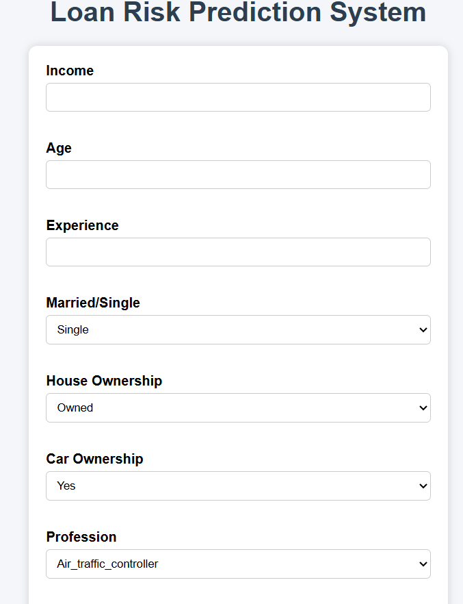
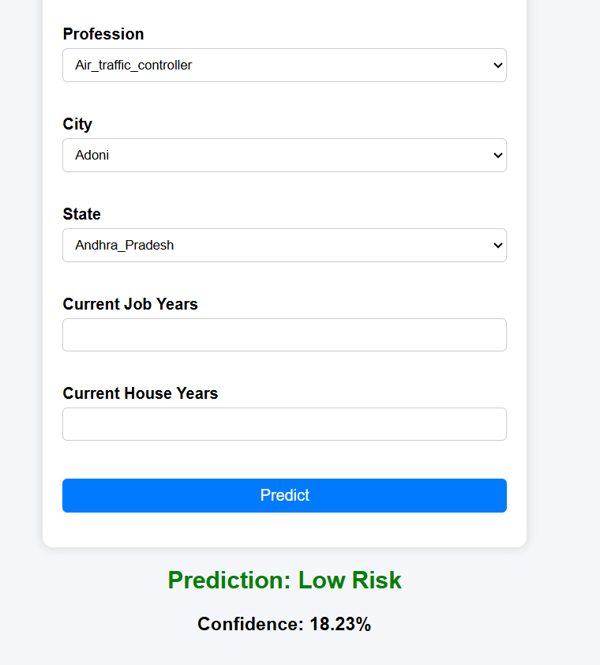

# Loan Risk Prediction System using Deep Learning


---

## 📌 Project Overview

The Loan Risk Prediction System is a Deep Learning-based web application that predicts whether a loan applicant is at **Low Risk** or **High Risk**. The application is built using an Artificial Neural Network (ANN) and deployed with Flask.

Users can enter applicant information through a web interface, and the trained model predicts the loan risk along with the prediction confidence.

---

## 🚀 Features

- Predicts Loan Risk (Low Risk / High Risk)
- Artificial Neural Network (ANN) Model
- Flask Web Application
- User-friendly HTML Interface
- Confidence Score Display
- Automatic Data Scaling
- Label Encoding for Categorical Features

---

## 🛠️ Technologies Used

- Python
- Pandas
- NumPy
- Scikit-learn
- TensorFlow / Keras
- Flask
- HTML
- CSS

---

## 📊 Dataset Features

The model uses the following input features:

- Income
- Age
- Experience
- Married/Single
- House Ownership
- Car Ownership
- Profession
- City
- State
- Current Job Years
- Current House Years

Target Variable:

- Risk_Flag

---

## 🧠 Deep Learning Model

Three ANN models were developed and compared.

- Model A
- Model B
- Model C

The best-performing ANN model was selected based on evaluation metrics, saved as `loan_risk_ann.keras`, and integrated into the Flask web application for real-time loan risk prediction.

---

## 🧠 Model Training

The ANN models were trained using:

- Optimizer: Adam
- Loss Function: Binary Crossentropy
- Activation Function: ReLU (Hidden Layers)
- Output Activation: Sigmoid
- Task: Binary Classification

---

## 📈 Evaluation Metrics

The model was evaluated using:

- Accuracy
- Precision
- Recall
- F1-Score
- Confusion Matrix
- Classification Report

---

## 📋 Requirements

- Python 3.11+
- TensorFlow
- Flask
- Pandas
- NumPy
- Scikit-learn
- Joblib

---

## 🌐 Flask Web Application

The application allows users to:

1. Enter applicant details.
2. Submit the form.
3. View the predicted loan risk.
4. View the prediction confidence.

---

## 📂 Project Structure

```
Loan-Risk-Prediction/
│
├── app.py
├── Loan Prediction.csv
├── loan_risk_ann.keras
├── scaler.pkl
├── label_encoders.pkl
├── requirements.txt
├── README.md
│
├── templates/
│   └── index.html
│
└── static/
    └── style.css
```

---

## ⚙️ Installation

Clone the repository

```bash
git clone https://github.com/AleezaUmer/Loan-Risk-Prediction.git
```

Go to the project folder

```bash
cd Loan-Risk-Prediction
```

Install dependencies

```bash
pip install -r requirements.txt
```

Run the application

```bash
python app.py
```

Open your browser

```
http://127.0.0.1:5000
```

---

## 📷 Application Output

The web application provides:

- Applicant Information Form
- Loan Risk Prediction
- Confidence Percentage

---

## 📷 Screenshots

### Home Page



### Prediction Result



---

## 📊 Model Performance

| Model | Accuracy | Precision | Recall | F1 Score |
|-------|----------|-----------|--------|----------|
| Model A | 87.70% | 1.0000 | 0.0002 | 0.0003 |
| Model B | 87.68% | 0.4242 | 0.0045 | 0.0089 |
| Model C | 87.66% | 0.4798 | 0.0345 | 0.0644 |

---

## 🎯 Model Selection

Although Model A achieved the highest accuracy, it was not suitable for this problem because it failed to identify high-risk applicants due to extremely low recall.

Model C was selected for deployment because it achieved better Recall and F1-Score, making it more effective for detecting risky loan applicants in real-world scenarios.

---

## 🚀 Future Improvements

- Improve prediction accuracy
- Deploy the application on Render or Railway
- Add user authentication
- Improve UI with Bootstrap
- Add charts and analytics dashboard

---

## 👩‍💻 Author

**Aleeza Umer**

Bachelor of Science in Artificial Intelligence (BSAI)

GitHub Repository: [Loan-Risk-Prediction](https://github.com/AleezaUmer/Loan-Risk-Prediction)

---

## 📄 License

This project is created for educational and learning purposes.